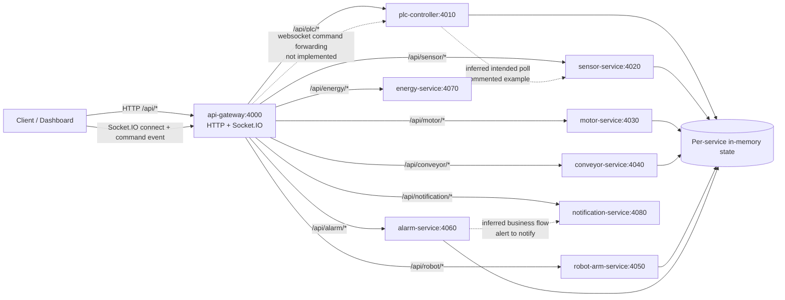

# PLC Services Architecture

## Scope
This document describes the runtime architecture currently implemented in `plc-services/`.

## Components and responsibilities

| Component | Port | Responsibility |
|---|---:|---|
| `api-gateway` | 4000 | Single HTTP entrypoint (`/api/*`) and Socket.IO server for dashboard/client connections. Proxies requests to internal services. |
| `plc-controller` | 4010 | PLC domain logic for machine state (`/machines`, `/command`, `/execute`). Contains a simulated scan cycle timer. |
| `sensor-service` | 4020 | Simulated sensor telemetry (`/temperature`, `/pressure`, `/vibration`, `/humidity`, `/proximity`) plus admin `/trigger`. |
| `motor-service` | 4030 | Motor state/status endpoints and failure trigger. |
| `conveyor-service` | 4040 | Conveyor speed/load/throughput state and delay trigger. |
| `robot-arm-service` | 4050 | Robot position/status/load and movement/failure endpoints. |
| `alarm-service` | 4060 | In-memory alert list and trigger endpoint. |
| `energy-service` | 4070 | Simulated energy consumption and peak endpoints. |
| `notification-service` | 4080 | Notification sink (`/send`) that logs outgoing messages. |

## Service boundaries and communication

### 1) Client-facing entrypoint
- Clients call the gateway on `http://localhost:4000`.
- Gateway route map (`api-gateway/index.js`) proxies:
  - `/api/plc/*` -> `plc-controller` (`http://localhost:4010/*`)
  - `/api/sensor/*` -> `sensor-service` (`http://localhost:4020/*`)
  - `/api/motor/*` -> `motor-service` (`http://localhost:4030/*`)
  - `/api/conveyor/*` -> `conveyor-service` (`http://localhost:4040/*`)
  - `/api/robot/*` -> `robot-arm-service` (`http://localhost:4050/*`)
  - `/api/alarm/*` -> `alarm-service` (`http://localhost:4060/*`)
  - `/api/energy/*` -> `energy-service` (`http://localhost:4070/*`)
  - `/api/notification/*` -> `notification-service` (`http://localhost:4080/*`)
- Path prefixes are removed by `pathRewrite`, so `/api/motor/status` at gateway becomes `/status` in `motor-service`.

### 2) Real-time channel
- `api-gateway` runs a Socket.IO server on the same port (4000).
- It accepts `command` events from clients and logs them.
- **Current implementation note:** no code currently forwards these websocket commands to other services.

### 3) Direct service-to-service behavior
- Explicit runtime HTTP calls between backend services are minimal in current code.
- `plc-controller` imports `axios` and has a periodic scan loop (`setInterval`) with a commented example sensor poll (`GET http://localhost:4020/temperature`).
- This indicates intended PLC->Sensor polling, but it is not active in the current implementation.

## External dependencies and infrastructure

### Persistence
- No database integration is present in `plc-services` source.
- Stateful data is in-memory within each process (arrays/objects), so state resets on restart.

### Queue/event bus
- No message queue or event bus (Kafka/RabbitMQ/NATS/etc.) is configured in this directory.

### Shared modules/libraries
- Common per-service libraries: `express`, `cors`.
- Gateway-specific: `http-proxy-middleware`, `socket.io`.
- PLC controller has `axios` for potential outbound HTTP calls.

### Configuration model
- Ports, route targets, and behavior are hardcoded in source files.
- Root `plc-services/package.json` starts all services in one process group using `concurrently`.
- Each service has its own Dockerfile (Node 18 Alpine, `npm start`, fixed exposed port).

## Request/data flow (implemented + inferred)

## Legend
- **Solid arrows**: behavior directly implemented in code.
- **Dashed arrows**: inferred/intended or currently non-active relationships.
- **Cylinder node (`MEM`)**: volatile in-memory process state (not an external database).

## Files inspected
- `plc-services/package.json`
- `plc-services/api-gateway/index.js`, `package.json`, `Dockerfile`
- `plc-services/plc-controller/index.js`, `package.json`, `Dockerfile`
- `plc-services/sensor-service/index.js`, `package.json`, `Dockerfile`
- `plc-services/motor-service/index.js`, `package.json`, `Dockerfile`
- `plc-services/conveyor-service/index.js`, `package.json`, `Dockerfile`
- `plc-services/robot-arm-service/index.js`, `package.json`, `Dockerfile`
- `plc-services/alarm-service/index.js`, `package.json`, `Dockerfile`
- `plc-services/energy-service/index.js`, `package.json`, `Dockerfile`
- `plc-services/notification-service/index.js`, `package.json`, `Dockerfile`

## Known limitations of this analysis
- No runtime traces were captured; this is static analysis from source/config.
- Some domain interactions are implied by comments/endpoint naming but not wired in code yet.
